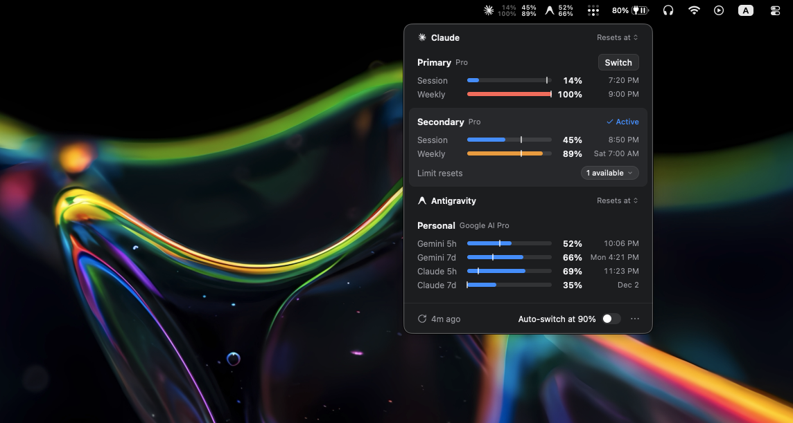
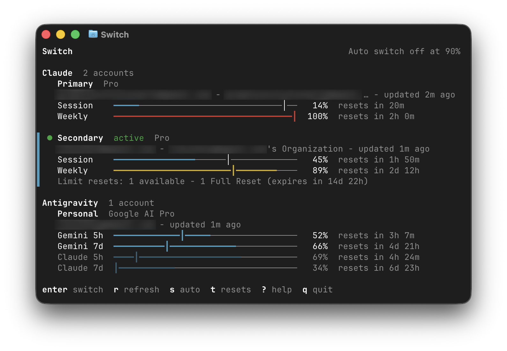

# Switch

Switch manages multiple accounts for subscription AI coding tools, tracks usage limits in real time, and swaps the active login safely. One background server (`swx serve`) owns account state, credentials, and usage polling; the macOS menu bar app, terminal dashboard, and CLI are thin clients over local HTTP and SSE.

> **Disclaimer:** Switch is intended for personal use only. It is provided as is, and I am not responsible for how it is used or for any consequences of using it, including account restrictions, lost logins, or violations of a provider's terms of service.

## Screenshots

### macOS menu bar app (`Switch.app`)

Tray icon with per-account usage columns (active and usage-only accounts at full opacity, inactive accounts dimmed) and the open popover panel:



### Terminal dashboard (`swx tui`)



## Supported providers

| Provider | ID | Account switching | Usage windows | How accounts are added |
| --- | --- | --- | --- | --- |
| Claude Code | `claude` | Yes | `Session`, `Weekly`, and model-specific windows | `swx add` (captures current Claude Code login) |
| Antigravity | `antigravity` | No (usage tracking only) | `Gemini 5h`, `Gemini 7d`, `Argon 7d`, `Claude 5h`, `Claude 7d` | `swx login` (browser Google OAuth; does not read or change the Antigravity app's login) |

Only Claude Code supports account switching today. Antigravity accounts are monitored for usage only and cannot be switched or auto-switched.

The core engine is provider-agnostic and designed to accommodate additional tools (see [docs/architecture.md](docs/architecture.md)).

## Interfaces

- **macOS menu bar app (`Switch.app`)**: Adaptive template tray icon showing provider marks and per-account usage columns. The popover panel displays aligned usage bars with pace ticks, a countdown/local reset time toggle, drag-to-reorder for accounts and providers, right-click actions (rename, pause/resume, remove), auto-switch toggle and threshold, and Settings to choose which providers, accounts, and usage windows appear in the panel and menu bar.
- **Terminal dashboard (`swx` / `swx tui`)**: Live OpenTUI dashboard synced over SSE with keyboard and mouse navigation, account/provider reordering, inline rename, pause/resume, remove, and auto-switch controls.
- **CLI (`swx`)**: Scriptable commands (`status`, `add`, `login`, `switch`, `use`, `refresh`, `serve`, `stop`) with aligned usage bars and color thresholds.

## Safe account switching and storage

Switch is built to avoid losing rotated refresh tokens, mixing accounts, or corrupting tool config:

- Acquires Claude Code's directory locks in order (`.oauth_refresh.lock`, `.claude.lock`, `.claude.json.lock`) with heartbeat and stale-lock takeover before modifying live state.
- Never renews a provider tool's live refresh token; only saved logins are renewed, with the rotated secret written to the vault before use.
- Verifies outgoing live-login ownership via token lineage and profile checks before overwriting it, and refuses the switch if ownership cannot be confirmed or conflicts with local config.
- Writes files atomically with rollback on failure, preserves `~/.claude.json` key order, numeric formatting, and machine-local credential fields, and never overwrites an unparseable config file.
- Stores saved credentials in macOS Keychain (`dev.switch.accounts`, with `0600` file fallback) or `0600` files under `SWITCH_HOME/logins/` on Linux, keeping a `<id>.previous` backup on each rotation.

## Installation

### Prerequisites

- Rust toolchain supporting edition 2024 (`cargo`, `rustc`)
- **macOS 13+** for `Switch.app` and `swx`
- **Linux (x64 or arm64)** for `swx`

### macOS (`Switch.app` + `swx`)

```sh
git clone https://github.com/kypexfly/switch.git
cd switch
./scripts/install-macos.sh
```

This fetches the pinned native OpenTUI library, builds and ad-hoc signs `Switch.app`, installs it to `/Applications/Switch.app` (override with `SWITCH_APP_DIR`), and symlinks `swx` into `~/.local/bin/swx` (override with `SWITCH_BIN_DIR`). Rerun the script to update.

### Linux (`swx`)

```sh
git clone https://github.com/kypexfly/switch.git
cd switch
./scripts/install-linux.sh
```

This fetches OpenTUI, builds a standalone `swx` binary, installs it to `~/.local/bin/swx` (override with `SWITCH_BIN_DIR`), and restarts the `switch` systemd user service if active.

> Note: The Linux path (`~/.claude/.credentials.json` and `logins/` file vault) has not yet been tested end-to-end on a real Linux machine.

## Quick start

### Claude Code

1. Sign in to your first account with Claude Code (`claude`), then save it:
   ```sh
   swx add
   ```
2. Sign in to another account with Claude Code, then run `swx add` again.
3. Switch accounts from `Switch.app`, `swx` (TUI), or the CLI:
   ```sh
   swx switch next
   swx switch best
   swx use 2
   ```
   Restart running Claude Code sessions after switching so they pick up the new login.

### Antigravity (usage tracking)

```sh
swx login
```

This opens a browser window for Google OAuth (or prints the URL to complete sign-in manually) and adds the account as usage-only.

### Try safely with demo data

Use `--demo` with a temporary `SWITCH_HOME` to test the server, TUI, and menu bar app with synthetic accounts without touching real logins or the macOS Keychain:

```sh
export SWITCH_HOME=$(mktemp -d)
cargo run -p switch-cli -- serve --demo

# In another terminal with the same SWITCH_HOME:
cargo run -p switch-cli -- tui
SWITCH_CLI=target/debug/swx cargo run -p switch-desktop
```

## CLI reference (`swx`)

| Command | Description |
| --- | --- |
| `swx` / `swx tui` | Open the interactive terminal dashboard (default) |
| `swx status` | Print providers, accounts, and usage bars |
| `swx add [provider]` | Verify and save the provider's current live login (defaults to `claude`) |
| `swx login [provider]` | Add an account via browser sign-in (defaults to the only `sign_in` provider) |
| `swx switch [next\|best] [--provider <id>]` | Switch to the next or least-used account (defaults to `next`, `claude`) |
| `swx use <account>` | Switch to an account by number from `swx status`, alias, email, or ID |
| `swx refresh` | Request a usage refresh and print the updated list |
| `swx serve [--demo] [--port <n>] [--no-auth]` | Run the background server in the foreground |
| `swx stop` | Stop the running server |

Running any client command auto-starts `swx serve --service` if no server is running for `SWITCH_HOME`.

## TUI controls

| Key / Input | Action |
| --- | --- |
| `up` / `down`, `j` / `k`, click | Select an account or provider row |
| `enter` | Switch to the selected account |
| `n` / `b` | Switch to the next / best account of the selected provider |
| `a` | Add the selected provider's current live login |
| `r` | Refresh usage |
| `e` | Pause or resume the selected account for switching |
| `m` | Rename the selected account (empty clears the alias) |
| `x` (then `y`) | Remove the selected account |
| `J` / `K` (or `shift+down` / `shift+up`) | Move the selected account down or up |
| `]` / `[` | Move the selected provider down or up |
| `s` | Toggle auto-switch |
| `+` / `-` | Adjust auto-switch threshold in 5% steps |
| `?` / `esc` | Toggle help overlay |
| `q` / `ctrl+c` | Quit |

## Running on a remote server

Switch can run headless on a remote Linux host via the systemd user unit in [contrib/switch.service](contrib/switch.service):

```sh
cp contrib/switch.service ~/.config/systemd/user/
systemctl --user enable --now switch
loginctl enable-linger "$USER"
```

The unit runs `swx serve --port 4590 --no-auth` on `127.0.0.1` so it can be exposed over a private tailnet with `tailscale serve --bg 4590` (never use `tailscale funnel`, which exposes the server publicly without authentication). See [docs/architecture.md](docs/architecture.md#running-on-a-server) for details.

## Configuration and data

| Environment variable | Purpose |
| --- | --- |
| `SWITCH_HOME` | Directory for `service.json`, `accounts.json`, `server.log`, `desktop.lock`, `desktop.json`, and `logins/` (default `~/.local/share/switch`) |
| `SWITCH_CLI` | Override path to `swx` spawned by `switch-desktop` (defaults to bundled sibling `swx`, then `PATH`) |
| `NO_COLOR` | Disable ANSI color output in `swx` |

## Development and docs

```sh
./scripts/fetch-opentui.sh
cargo test --workspace
cargo clippy --workspace --all-targets -- -D warnings
```

- [docs/architecture.md](docs/architecture.md) - System model, HTTP/SSE API, poll scheduler, safe switching, and adding providers
- [docs/claude-swap-parity.md](docs/claude-swap-parity.md) - Feature comparison checklist with `claude-swap`
- [AGENTS.md](AGENTS.md) - Workspace layout, safety rules, and development workflow

## Inspiration and acknowledgments

Switch is heavily inspired by two open-source projects:

- [OpenUsage](https://github.com/robinebers/openusage) - Inspiration for the macOS menu bar experience, multi-provider usage tracking, and provider assets (including the Antigravity logo mark)
- [claude-swap (`cswap`)](https://github.com/realiti4/claude-swap) - Inspiration for safe Claude Code account switching, lock/credential handling, and the interactive TUI workflow (tracked in [docs/claude-swap-parity.md](docs/claude-swap-parity.md))

## License

MIT - see [LICENSE](LICENSE).
